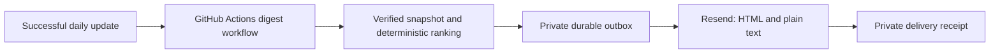

# Personal daily shortlist

After a successful **Daily job watch** update, GitHub Actions emails up to
**five** unseen early-career investment roles directly through Resend. Each
role includes an employer application link, location, experience evidence,
short duties excerpt and explainable score. The professional template provides
both HTML and plain-text alternatives.

Delivery runs in GitHub's cloud while the computer and desktop app are closed.
The former Codex/Gmail automation has been removed. Python performs selection,
formatting, sending and receipt handling without an AI runtime.

## Ranking and location

| Component | Maximum | Evidence |
|---|---:|---|
| Career fit | 50 | Portfolio construction and allocation lead, followed by portfolio research, investment research and investment decision support. |
| Experience | 35 | Internships and a stated minimum of zero or one year lead; a minimum of two years scores slightly lower. |
| Duties | 10 | Analytical work involving portfolios, investments, securities, funds, trading or investment performance. |
| Recency | 5 | When the tracker first observed the opening. |

Only open roles with an early-career signal qualify. The threshold is 65/100.
Senior roles, MBA/PhD-specific title tracks, stale observations, inactive
sources, invalid application links and previously emailed posting IDs are
excluded. Closely duplicated titles and application URLs appear once.

Every role must be **remote or offer a Texas location**. Multi-location
postings qualify when Texas is one option. Exact city-only labels for Austin,
Dallas, Houston, San Antonio and Fort Worth are recognized. A contrary state
qualifier such as Austin, MN does not qualify. Remote jobs restricted to
another state or country, hybrids outside Texas and unclear locations are
excluded. Generic remote listings are accepted with a reminder to confirm
the employer's location restrictions.

The digest sends fewer than five when fewer qualify. With no unseen qualifying
roles, it sends a brief no-match update. Scores rank discovery fit; employers
determine applicant eligibility. Browse retains the full geographic watchlist.

## Cloud delivery



`.github/workflows/digest.yml` runs after **Daily job watch** completes
successfully on `main`. An hourly backup recovers delayed events and transient
delivery failures. The script independently verifies the data timestamp falls
within a completed successful daily run, reads status and history at one fixed
commit, requires current successful source checks and rejects snapshots older
than 36 hours.

One digest is allowed per UTC **data-update date**, including when the backup
collection succeeds the same day. Existing sent dates and posting IDs were
migrated from the previous sender, preserving duplicate protection.

## Private configuration and receipts

The public repository's Actions secrets contain:

- `RESEND_API_KEY`: dedicated sending-only provider key.
- `DIGEST_FROM`: sender on an existing verified domain.
- `DIGEST_TO`: the sole recipient.
- `DIGEST_STATE_SSH_KEY`: write access to the separate private history repository.

`Hutch2064/job-watcher-delivery` is a **private** Git repository holding the
outbox, exact request content and delivery receipts. It is checked out only by
the delivery workflow with its own repository-scoped deploy key. Missing or
invalid history stops delivery. Recipient addresses, content, message IDs,
credentials and the private checkout are excluded from Pages and public logs.

The exact outgoing request and a sending reservation are pushed to private
history **before** the provider is called. After provider acceptance, its
message ID is saved and pushed. A failed pre-send push prevents sending.

Retries use an identical request and a stable per-day idempotency key. Resend
retains these keys for 24 hours, so automatic recovery is limited to 23 hours.
If a response or receipt push is uncertain, the next workflow safely recovers
the same provider ID inside that window. An older unresolved attempt stops
for provider-receipt reconciliation instead of blindly sending again.
GitHub reports workflow failures through its normal Actions notifications.

## Verification and maintenance

```bash
# Exercise the cloud worker against the real private history without sending.
gh workflow run digest.yml -f dry_run=true

# Verify real provider delivery and duplicate protection using its simulator.
gh workflow run digest.yml -f dry_run=true -f verify_provider=true

# Run the worker normally; already-delivered UTC dates are skipped.
gh workflow run digest.yml

# Run ranking, geography, template, persistence and delivery-recovery tests.
python3 -m pytest -q
```

`digest.py` remains the deterministic ranking/template library and provides
local preparation and receipt commands for maintenance. `cloud_digest.py`
handles direct provider delivery and the private outbox. No model or connected
Gmail tool participates in scheduled delivery.

Tests cover the five-role cap, score ordering, geography, prior deliveries,
MIME alternatives, required state persistence, uncertain outcomes, identical
idempotent retries and expired retry refusal. CI also checks the email layout
at desktop and mobile widths. Provider simulation uses Resend's documented
test-delivery address without sending an extra daily digest to the recipient.
